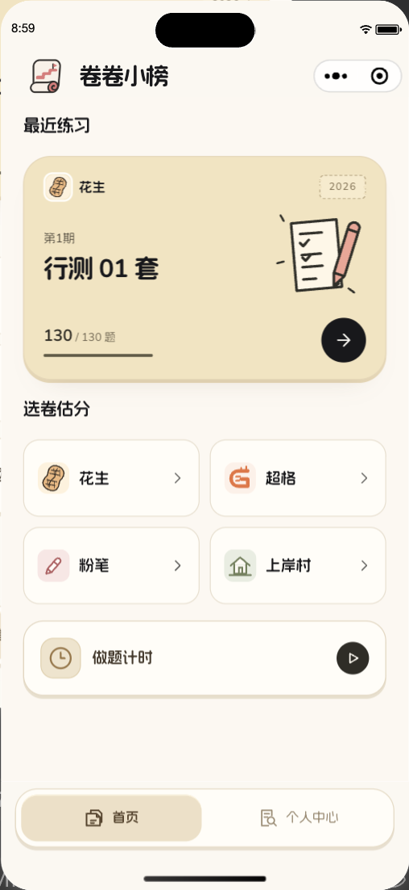
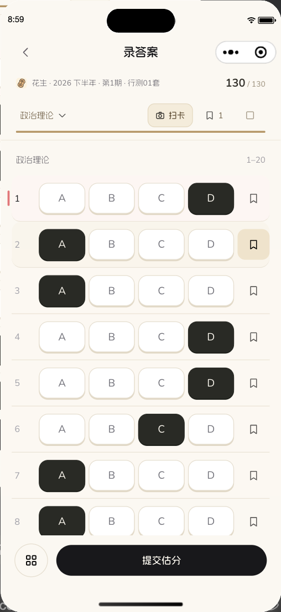
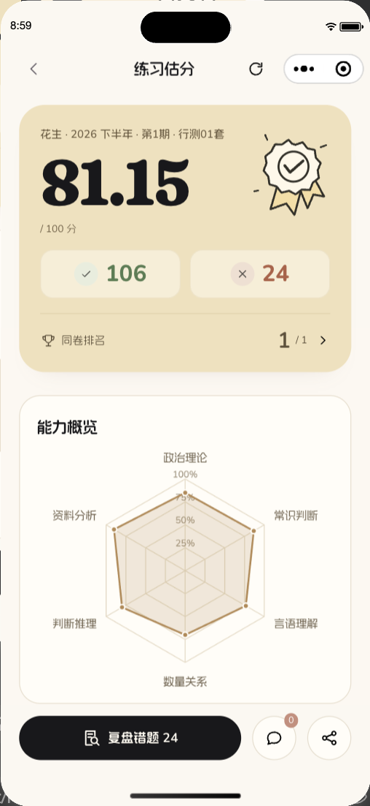

<h1 align="center">
  
</h1>

<p align="center"><strong>行测计时、答题卡估分与同卷复盘</strong></p>

<p align="center">
  <a href="#微信小程序">小程序</a> ·
  <a href="#界面预览">界面预览</a> ·
  <a href="#本地开发">本地开发</a> ·
  <a href="#项目文档">文档</a>
</p>

## 界面预览

<p align="center">
  <a href="assets/readme/mini-home.png"></a>&nbsp;
  <a href="assets/readme/mini-practice.png"></a>&nbsp;
  <a href="assets/readme/mini-report.png"></a>
</p>

<p align="center"><strong>选卷计时 · 录答与扫卡 · 成绩报告</strong><br>
点击查看原图，报告使用示例答卷。</p>

## 功能一览

- **选卷与计时**　从花生、超格、粉笔、上岸村选卷。整卷或分模块计时，分别记录做题和录答用时。
- **录答与估分**　拍照或从相册选取答题卡，核对识别结果后填入。手动录答也支持标记存疑题和继续草稿。
- **同卷复盘**　查看逐题对照、板块得分、全国榜和岗位榜，按考试类别追踪多次练习的成绩。
- **分享与反馈**　保存报告长图、成绩卡、题型图或雷达图，参与同卷讨论或提交答案订正。

估分使用本卷的参考答案和分值，实际成绩以考试组织方为准。 [计分口径](docs/scoring-reference.md)

## 微信小程序

<p align="center">
  <br>
  微信扫一扫，打开卷卷小榜
</p>

## 本地开发

需要 **Node.js 20 或以上**。在仓库根目录安装依赖并启动手机网页版。

```bash
npm ci
npm run dev:ios
```

打开 [手机网页版](http://127.0.0.1:4781/ios-v3/?design=paper-cards-1114-v3)。运行 `npm start` 可打开 [基础网页版](http://127.0.0.1:4173/)，体验批量粘贴答案、练习备份和套卷管理。

开发原生小程序时，用微信开发者工具打开 `mini-program/`。本机联调可生成连接独立回环 API 的验收包。 [小程序开发与测试环境](mini-program/README.md#测试环境)

### 验证与构建

`npm test` 运行自动化测试。`npm run build` 构建基础网页版，`npm run preview` 启动构建产物。评分、导入与发布由 Node.js API 提供。

<details>
<summary>完整验收与浏览器截图</summary>

完整验收需要 Python 3.10 或以上、uv、Playwright、Chromium 和手机网页版的 beUI 依赖。

```bash
npm ci --prefix docs/ui-exploration/ios-v3/ui
uv sync --frozen --group verify
uv run --frozen --group verify python -m playwright install --with-deps chromium
npm run verify -- doctor
npm run verify -- all
```

`npm run verify -- visual` 保存 320、390、430 像素和桌面布局截图。`npm run verify -- feature positions-rank` 可单独核对选岗与榜单。GitHub Actions 的 `RollieRank verification` 工作流保留日志、断言和截图。 [验证功能图谱](.agents/skills/verify-rollierank/features/README.md)

</details>

## 项目文档

- **开发**　[小程序开发](mini-program/README.md) · [手机网页版](docs/ui-exploration/ios-v3/README.md)
- **数据**　[套卷资料](docs/import-question-banks.md) · [计分](docs/scoring-reference.md) · [岗位导入](docs/import-positions.md)
- **识别**　[答题卡识别（OMR）](docs/integration-omr.md)
- **运维**　[部署与备份](deploy/README.md) · [产品站点](site/README.md)

源码从 [`mini-program/`](mini-program/)、[`src/`](src/) 和 [`server/`](server/) 开始读，依次对应原生小程序、基础网页版与计分 API。

<details>
<summary>基础网页版的批量录答与计分</summary>

电脑可用 A–D 录答，左右方向键换题，Backspace 或 Delete 清除。手机网页可从录答页底部打开答题卡和批量粘贴。

| 粘贴格式 | 示例 |
| --- | --- |
| 连续选项 | `ABCD-ABCD` |
| 带题号 | `1.A 2.B 3.C 130.D` |
| 分组题号 | `1-5 ABCDA 6-10 BCDAB` |

`-`、`_` 和 `?` 表示留空。系统按当前套卷校验题号、范围和选项，确认前显示将覆盖的范围与数量。

答对得对应分值，答错和留空计 0 分。得分率是得分除以满分，正确率是答对题数除以总题数。花生一期的 130 题按下表计分，其他套卷各用自己的分值表或参考权重。

| 题型 | 题号 | 每题分值 | 满分 |
| --- | --- | ---: | ---: |
| 政治理论 | 1–20 | 0.5 | 10 |
| 常识判断 | 21–35 | 0.5 | 7.5 |
| 言语理解 | 36–65 | 0.8 | 24 |
| 数量关系 | 66–75 | 1 | 10 |
| 图形推理 | 76–85 | 0.8 | 8 |
| 定义判断 | 86–95 | 0.8 | 8 |
| 类比推理 | 96–100 | 0.8 | 4 |
| 逻辑判断 | 101–110 | 0.85 | 8.5 |
| 资料分析 | 111–130 | 1 | 20 |

</details>

<details>
<summary>导入套卷与审核答案订正</summary>

启动服务时设置 `ROLLIERANK_REVIEW_TOKEN`，再从基础网页版侧栏解锁「套卷管理」。填写机构、项目、期数、卷别和卷名后上传 CSV。

```csv
题号,题型,答案,分值
1,政治理论,A,0.5
2,政治理论,B,0.5
3,言语理解,C,0.8
```

自定义套卷支持 1–300 道单选题。题号须从 1 连续编号，答案为 A–D，分值最多两位小数。校验和试算后保存草稿，再预览和发布。修订导入会保留旧版报告，题量或题型结构变化时需新建套卷。

维护者可在「答案反馈审核」试算并确认订正。审核通过后，服务重算该版本的受影响成绩，并保留原作答、用时和审核记录。

</details>

<details>
<summary>榜单口径与本机数据</summary>

同卷榜自动选用每人最高的正式成绩，公开昵称、总分与板块分数。个人选项保留在本人报告。网页版群体统计按同版本每人最佳完整答卷汇总，留空计入分母。

浏览器在 `localStorage` 保存草稿、身份和成绩快照，可在「我的记录」导出或恢复 JSON。服务端的套卷配置、提交记录、选岗、讨论、反馈及审核数据保存在 `.local/catalog.json`，可以通过 `ROLLIERANK_DATA_DIR` 指定独立目录。迁移本机服务时需一并备份浏览器导出文件和服务端数据目录。

</details>

## 许可证

[GPL-3.0](LICENSE)
