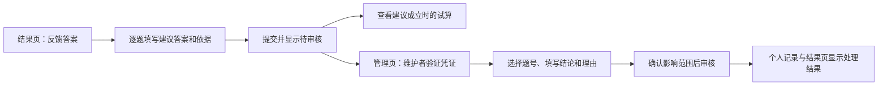

# 反馈、审核与答案订正

## 数据与事务

服务模块通过 readCatalog 读取目录，通过 mutateCatalog 的同步回调修改目录。features.corrections 保存反馈、逐题结论、审核记录和订正修订。答卷仍保存在公共 receipts 中。

每份反馈绑定套卷版本、答卷、反馈者和提交时的答案修订号。每题保存原参考答案、建议答案与依据。提交反馈不修改套卷或成绩；试算对版本副本调用 gradeVersion。

审核请求携带维护者凭证、独立审核编号、所选题号、结论、理由及预期修订号。服务端验证部署配置的凭证，只持久化业务字段。同一审核编号可安全重试；已处理的题号不可重复审核。批准时检查当前修订及相关题号的答案历史，阻止过期依据覆盖后续订正。无关题号的订正不使反馈自动失效。

批准操作在同一 mutateCatalog 回调内修订标准答案，对该版本全部 receipts 使用 gradeVersion 重算，保留原答卷和提交时间。答卷记录订正修订号及前后成绩；服务命名空间保留完整处理审计。父级持久化失败时回滚全部状态。

## 页面方案

沿用现有卡片、按钮、原生表单和 dialog，复用 src/ui.js 的转义与格式化工具。反馈、通知和审核分别放入公共契约的三个挂载点，保留现有页面构图与颜色。交互属性使用 data-correction-action。

反馈弹窗先显示套卷与参考答案版本，再逐题填写题号、建议答案、核对依据。可增加和删除题目，失败保留输入，保存期间禁用重复提交。反馈详情显示逐题状态及试算，试算明确标注为假设结果。

管理区域先显示待审核数量。维护者在密码输入框提供凭证，仅保存于模块内存，退出或刷新后重新输入。审核详情同时呈现题号、原答案、建议答案、依据与当前状态。确认批准前显示题数、受影响答卷数和审核理由。

个人记录展示自己的反馈及受影响答卷的订正通知。通知说明题号、答案修订号、理由和成绩前后变化，可打开原报告。

桌面使用对齐的答案比较行；320px 起改为纵向表单与换行操作，不隐藏必要字段。加载、空队列、未授权、过期依据、保存失败和同步失败各有可恢复状态。确认弹窗复用公共 dialog；键盘和焦点行为在隔离页面中检查，公共整页接入由协调任务复验。

## 验证

服务测试使用临时目录和串行事务容器，覆盖持久化、凭证拒绝、多题允许与拒绝、重试、并发、过期依据、重算算法、未来提交、成绩刷新及落盘失败回滚。浏览器测试使用独立入口加载三个挂载点，检查表单、审核、试算、通知和窄屏布局。公共应用的最终接入和全系统回归另行记录。
